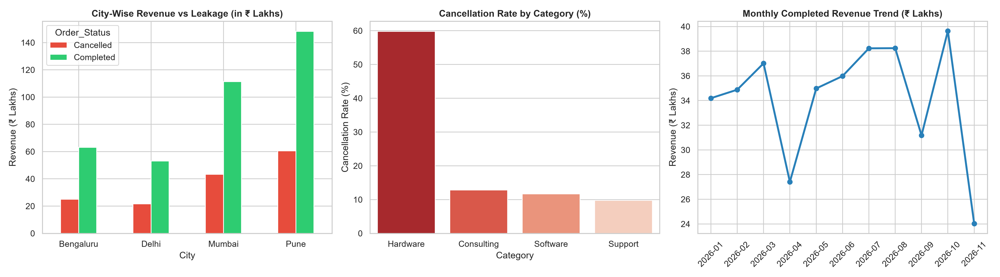

# 📊 End-to-End Business Revenue, Retention & AI Risk Analytics (MySQL + Python + ML)

## 📌 Project Overview
An end-to-end data analytics and machine learning solution designed to uncover regional revenue drivers, quantify financial losses from cancelled orders (revenue leakage), and predict high-risk order cancellations using *MySQL, **Python, and **Scikit-Learn*.

## 🛠️ Tech Stack & Architecture
* *Database & Querying:* MySQL (Relational Schema, CTEs, Window Functions RANK() & LAG(), Views, Stored Procedures)
* *Data Engineering & EDA:* Python (Pandas, NumPy, Matplotlib, Seaborn)
* *Predictive AI / ML:* Scikit-Learn (Random Forest Classifier for Cancellation Risk Scoring)

## 📈 Key Business Insights & Impact
* *Revenue & Leakage Scale:* Analyzed *2,012 multi-city transactions, identifying *₹3.75 Cr** in completed revenue and *₹1.50 Cr* in revenue leakage caused by cancellations.
* *Top Performing Market:* *Pune* emerged as the highest revenue-generating market, followed by Mumbai.
* *Root-Cause Risk Identification:* The *Hardware* category showed a critical *59.8% cancellation rate*, making it the primary driver of revenue loss.
* *Predictive AI Engine (81.39% Accuracy):* Trained a *Random Forest Classifier* that flagged *252 high-risk orders (>55% cancellation probability)* and generated an automated executive action report (High_Risk_Orders_Alert.csv).

## 💡 Strategic Recommendations
1. *Mitigate Hardware Leakage:* Implement a 20% advance deposit or pre-dispatch verification call for Hardware orders exceeding ₹35,000.
2. *VIP Retention Program:* Launch targeted loyalty incentives in top-performing hubs (Pune & Mumbai) to maximize customer lifetime value.

## 📊 Visual Insights

